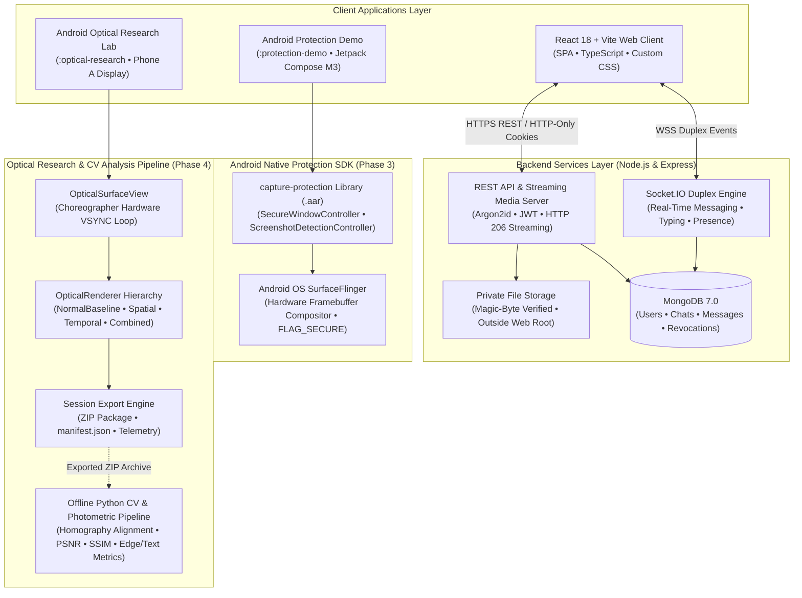
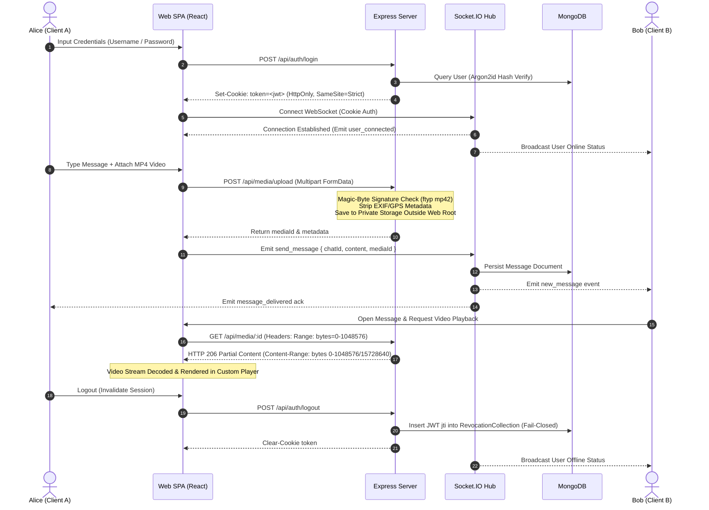
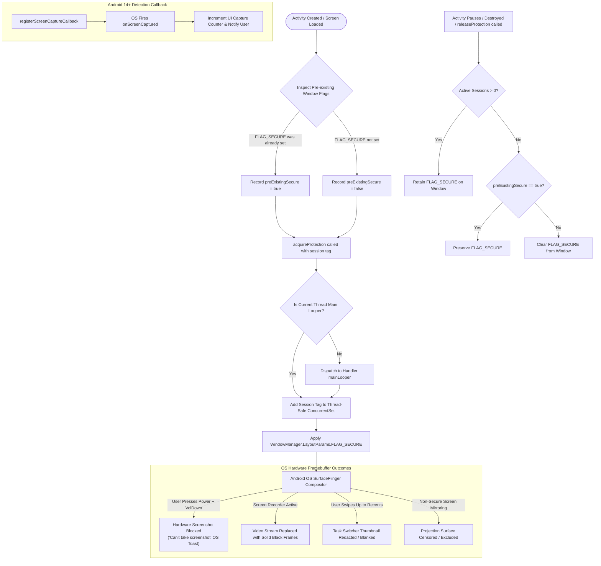
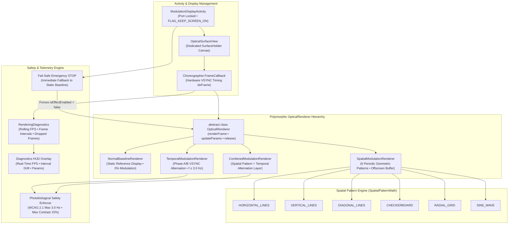
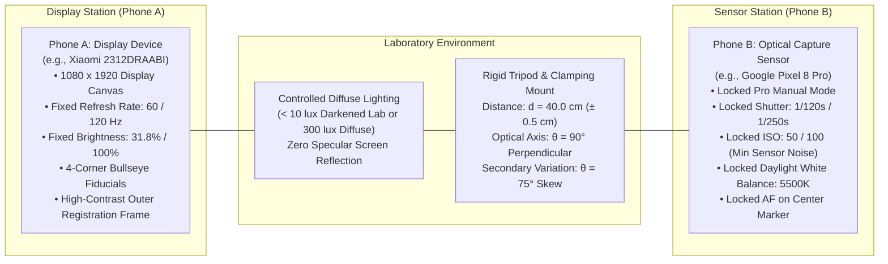
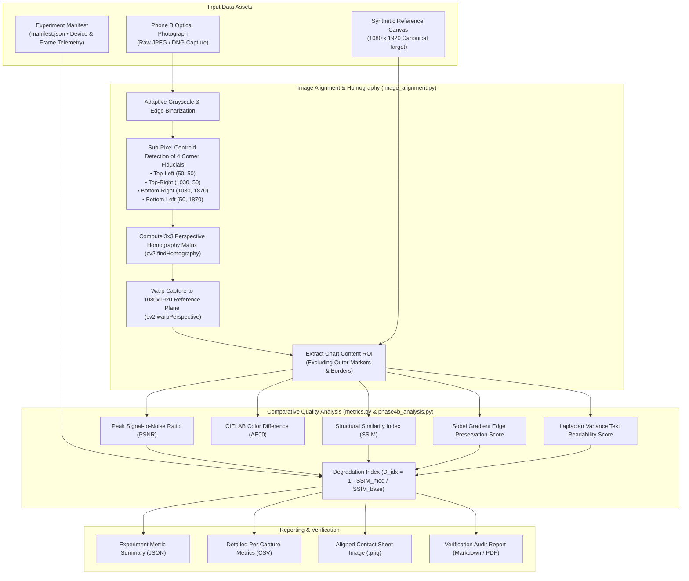

<p align="center">
  
  
  
  
  
  
  
  
  
  
  
  
</p>

# 🔒 Veil — Private Messenger & Optical Anti-Capture Platform

> A privacy-centric communication platform unifying end-to-end real-time duplex messaging, native mobile operating system compositor protection, and pioneering optical anti-capture display research against external physical cameras.

---

## 📑 Table of Contents

- [🌟 Executive Overview](#-executive-overview)
- [🎯 The Dual Threat Model: Digital Leaks vs. The Analog Hole](#-the-dual-threat-model-digital-leaks-vs-the-analog-hole)
- [🗺️ Multi-Phase Roadmap & Delivery Status](#️-multi-phase-roadmap--delivery-status)
- [🏗️ System & Research Architecture (Workflow Graphics)](#️-system--research-architecture-workflow-graphics)
  - [1. Multi-Tiered System Architecture](#1-multi-tiered-system-architecture)
  - [2. Real-Time Messaging & Streaming Media Workflow](#2-real-time-messaging--streaming-media-workflow)
  - [3. Native Android Window Protection Workflow (Phase 3)](#3-native-android-window-protection-workflow-phase-3)
  - [4. Optical Anti-Capture Research Architecture & Rendering Engine (Phase 4A & 4B)](#4-optical-anti-capture-research-architecture--rendering-engine-phase-4a--4b)
  - [5. Two-Phone Physical Optical Capture Laboratory Setup](#5-two-phone-physical-optical-capture-laboratory-setup)
  - [6. Offline Computer Vision Alignment & Photometric Evaluation Pipeline](#6-offline-computer-vision-alignment--photometric-evaluation-pipeline)
- [✨ Core Capabilities by Phase](#-core-capabilities-by-phase)
  - [Phase 1: Real-Time Messaging & Fail-Closed Authentication](#phase-1-real-time-messaging--fail-closed-authentication)
  - [Phase 2: Secure Media Streaming & Lifecycle Controls](#phase-2-secure-media-streaming--lifecycle-controls)
  - [Phase 3: Native Android Capture Protection SDK & Demo App](#phase-3-native-android-capture-protection-sdk--demo-app)
  - [Phase 4A: Optical Research Lab Baseline Capture System](#phase-4a-optical-research-lab-baseline-capture-system)
  - [Phase 4B: Spatial, Temporal & Combined Display Modulation Lab](#phase-4b-spatial-temporal--combined-display-modulation-lab)
- [📂 Monorepo Repository Structure](#-monorepo-repository-structure)
- [🚀 Quickstart & Setup Guide](#-quickstart--setup-guide)
  - [Prerequisites](#prerequisites)
  - [1. Web Client & Backend Server Setup](#1-web-client--backend-server-setup)
  - [2. Android Capture Protection SDK & Demo App](#2-android-capture-protection-sdk--demo-app)
  - [3. Android Optical Research Lab App](#3-android-optical-research-lab-app)
  - [4. Python Offline Computer Vision Pipeline](#4-python-offline-computer-vision-pipeline)
- [📦 Integrating the Android Capture Protection SDK](#-integrating-the-android-capture-protection-sdk)
- [🧪 Automated Testing & Verification Suite](#-automated-testing--verification-suite)
- [🛡️ Security Model, Hardware Boundaries & Analog Hole Theory](#️-security-model-hardware-boundaries--analog-hole-theory)
- [👥 Verification Audits & Documentation](#-verification-audits--documentation)
- [📄 License & Attribution](#-license--attribution)

---

## 🌟 Executive Overview

**Veil** is an end-to-end security and communications system engineered to protect private human visual exchanges across both software abstractions and physical boundaries:

1. **Digital Layer**: Prevents malicious or accidental capture on the recipient's device via operating-system compositor hooks (`FLAG_SECURE`), reference-counted window session lifecycle management, and Android 14+ screenshot detection callbacks.
2. **Physical Boundary (The "Analog Hole")**: Formulates, implements, and benchmarks real-time display modulation algorithms (spatial Bayer filter interference, VSYNC-synchronized temporal alternation, and combined perturbation) designed to degrade third-party camera captures while preserving human readability and complying with international photobiological safety standards (WCAG 2.1).

The repository is structured as a production monorepo hosting the real-time web application, the backend API & media streaming server, the standalone reusable Android protection library (`.aar`), the Jetpack Compose verification app, the experimental Android optical research lab, and the Python offline photometric analysis pipeline.

---

## 🎯 The Dual Threat Model: Digital Leaks vs. The Analog Hole

```
                                  ╔═══════════════════════════════════════════════════════╗
                                  ║             VEIL UNIFIED THREAT MODEL                 ║
                                  ╚═══════════════════════════════════════════════════════╝

    [THREAT VECTOR 1: DIGITAL SOFTWARE ATTACKS]                   [THREAT VECTOR 2: PHYSICAL "ANALOG HOLE"]
    ──────────────────────────────────────────                   ─────────────────────────────────────────
    • OS Screen Recording                                        • External Smartphone Photography
    • Hardware Key / Power-Vol Screenshot Capture                • Covert Optical Sensors & Spy Cameras
    • Android Task Switcher / Recent Apps Preview                • Camcorders / High-Framerate Video Recorders
    • Non-Secure Display Miracast / HDMI Projections             • Secondary Lens Eavesdropping
                         │                                                            │
                         ▼                                                            ▼
     ┌───────────────────────────────────────┐                    ┌───────────────────────────────────────┐
     │  Phase 3: Android Protection SDK      │                    │  Phase 4: Optical Modulation Lab      │
     │  • WindowManager FLAG_SECURE          │                    │  • Spatial Bayer CFA Interference     │
     │  • SurfaceFlinger Framebuffer Blanks  │                    │  • Hardware Choreographer VSYNC       │
     │  • Activity.ScreenCaptureCallback     │                    │  • Temporal Flicker (f ≤ 3.0 Hz)      │
     │  • Safe Reference-Counted Registry    │                    │  • Combined Spatial-Temporal Perturb  │
     └───────────────────────────────────────┘                    └───────────────────────────────────────┘
                         │                                                            │
                         ▼                                                            ▼
    [OUTCOME: Software captures blanked out]                     [OUTCOME: Camera image degraded / noisy]
```

---

## 🗺️ Multi-Phase Roadmap & Delivery Status

| Phase | Milestone Name | Status | Technical Scope & Key Deliverables |
|---|---|---|---|
| **Phase 1** | Core Real-Time Messaging | ✅ **Completed** | Full auth, Argon2id hashing, durable fail-closed JWT revocation, MongoDB persistence, Socket.IO duplex messaging, typing indicators, user presence. |
| **Phase 2** | Secure Media Messaging & Custom Viewer | ✅ **Completed** | Magic-byte signature verification, EXIF/GPS stripping, isolated disk storage, HTTP 206 chunked video streaming, custom full-screen media viewer, soft-delete & tombstoning, Unicode emoji picker. |
| **Phase 3** | Native Android Digital Capture Protection SDK | ✅ **Completed** | Reusable `capture-protection` library (`.aar`), reference-counted `SecureWindowController`, thread/lifecycle safety, pre-existing flag preservation, Android 14+ `ScreenCaptureCallback`, Material 3 `protection-demo` app, physical hardware validation on Xiaomi (Android 15) & Pixel. |
| **Phase 4A** | Optical Anti-Capture Research Lab & Baseline System | ✅ **Completed** | Dedicated Android app (`:optical-research`), 7 deterministic synthetic test charts, 4-corner bullseye fiducials, offline Python computer vision pipeline (subpixel homography, PSNR, SSIM, CIELAB $\Delta E_{00}$). Baseline dataset (7 experiments, 21 calibrated captures) published. |
| **Phase 4B** | Spatial, Temporal & Combined Display Modulation Lab | ✅ **Completed** | 6 spatial pattern generators (`SpatialPatternMath`), Choreographer VSYNC temporal alternation, combined modulation, WCAG 2.1 compliance ($f \le 3.0\text{ Hz}$, contrast $\le 15\%$), fail-safe Emergency Stop, live `RenderingDiagnostics` HUD, automated unit tests, and comparative Python evaluation suite (`phase4b_analysis.py`). |
| **Phase 5** | Native Android Protection Engine | 🔲 Planned | Low-level C++ / NDK, OpenGL ES 3.0 / Vulkan rendering pipeline for zero-overhead display compositing. |
| **Phase 6** | Native Protected Messenger Client | 🔲 Planned | Full native Android messenger port embedding the capture-protection SDK and display modulation engine. |
| **Phase 7** | View-Once & Ephemeral Media Architecture | 🔲 Planned | Self-destructing visual attachments, cryptographic burn-after-reading timers, and server-side hard purge. |
| **Phase 8** | Ambient & Display Adaptive Protection | 🔲 Planned | Sensor-driven dynamic parameter adaptation (ambient light lux sensor, panel OLED subpixel geometry, display refresh rate). |
| **Phase 9** | ML Capture Optimization & Adversarial Tuning | 🔲 Planned | Generative adversarial capture optimization targeting neural super-resolution and camera denoisers. |

---

## 🏗️ System & Research Architecture (Workflow Graphics)

### 1. Multi-Tiered System Architecture

The following diagram illustrates the complete architectural topology of the Veil ecosystem, showing how client applications, backend communication engines, Android hardware compositors, and offline computer vision analysis components interface:



---

### 2. Real-Time Messaging & Streaming Media Workflow

This sequence diagram depicts user authentication, real-time Socket.IO message exchange, magic-byte media upload, chunked video streaming, and fail-closed token revocation:



---

### 3. Native Android Window Protection Workflow (Phase 3)

The following state and decision flowchart details how `SecureWindowController` enforces hardware-backed protection inside the Android OS compositor, isolates windows, and processes screenshot detection:



---

### 4. Optical Anti-Capture Research Architecture & Rendering Engine (Phase 4A & 4B)

This graph displays the class hierarchy, hardware VSYNC synchronization, modulation modes, and telemetry diagnostics engine inside the `:optical-research` module:



---

### 5. Two-Phone Physical Optical Capture Laboratory Setup

The following diagram illustrates the physical, geometric, and optical parameters governing the two-phone experimental baseline and modulation captures:



---

### 6. Offline Computer Vision Alignment & Photometric Evaluation Pipeline

This diagram shows how raw camera capture photos exported from Phone A/B are processed by the offline Python CV pipeline to calculate subpixel homographies and objective degradation metrics:



---

## ✨ Core Capabilities by Phase

### Phase 1: Real-Time Messaging & Fail-Closed Authentication
- **Duplex Messaging**: Socket.IO bidirectional connection with automatic reconnection, heartbeat, and connection-state resilience.
- **Typing Indicators & Presence**: Sub-second typing debouncing and accurate online/offline presence tracking with last-seen timestamps.
- **Fail-Closed JWT Revocation**: In-memory token revocation cache backed by a persistent MongoDB collection. Revocation checks execute on every authenticated route and WebSocket handshake. If the revocation store becomes unreachable, the auth layer defaults to **deny (fail-closed)**.
- **Argon2id Password Hashing**: State-of-the-art memory-hard key derivation protecting user passwords against GPU/ASIC cracking.

### Phase 2: Secure Media Streaming & Lifecycle Controls
- **Magic-Byte Signature Inspection**: Real file signature validation preventing extension/MIME-type spoofing (validates actual header bytes for JPEG, PNG, WebP, MP4, WebM).
- **Private Storage Isolation**: Uploaded media is persisted outside the public web root with cryptographically random opaque filenames.
- **Chunked Video Streaming (HTTP 206)**: Byte-range seeking support (`Range: bytes=start-end`) enabling instantaneous seeking and progressive video buffering.
- **EXIF & Privacy Stripping**: Automatic removal of GPS location data, camera serial numbers, and camera metadata upon upload.
- **Message Deletion**: Supports soft-delete for myself and universal tombstoning ("*This message was deleted.*") with real-time Socket.IO broadcasts.
- **Unicode Emoji Picker**: Built-in categorized picker with recent history, keyboard shortcuts, and cursor-aware text injection.

### Phase 3: Native Android Capture Protection SDK & Demo App
- **Standalone Library (`:capture-protection`)**: Decoupled Android Archive (`.aar`) containing zero UI or navigation dependencies, allowing drop-in integration into any Android app.
- **Reference-Counted Window Protection**: `SecureWindowController` manages multiple active protection requests on an `Activity` window using a thread-safe registry.
- **Pre-Existing Flag Preservation**: Detects whether `FLAG_SECURE` was already present before the SDK acquired the window, preventing unintentional security drops during session cleanups.
- **Lifecycle Integration**: `attachLifecycle(LifecycleOwner)` automatically cleans up protection sessions when an Activity is destroyed.
- **Android 14+ Screenshot Detection**: `ScreenshotDetectionController` implements `Activity.ScreenCaptureCallback` with safe fallback on older API levels.
- **Interactive Verification Demo App (`:protection-demo`)**: 100% Jetpack Compose and Material 3 application featuring live hardware telemetry, baseline vs. protected viewers, and an interactive 6-checkpoint QA checklist.

### Phase 4A: Optical Research Lab Baseline Capture System
- **Dedicated Research Display Application (`:optical-research`)**: Android APK designed to run on Phone A, keeping the screen awake (`FLAG_KEEP_SCREEN_ON`) and locking portrait orientation.
- **7 Deterministic Synthetic Test Charts**:
  1. `Colour Calibration Chart` (24 standard color patches)
  2. `Grayscale Gradient Chart` (10-step step wedge & smooth linear gradient)
  3. `Checkerboard Grid Chart` (Alternating high-frequency pixel blocks)
  4. `Fine-Line & Resolution Target` (1px, 2px, 4px line patterns)
  5. `High-Contrast Edge & MTF Target` (Slanted edges for edge spread function analysis)
  6. `Typographic Legibility Check` (Multi-size micro-text legibility ladders)
  7. `Master Combined Quality Target` (Consolidated multi-feature target)
- **Subpixel Fiducial Alignment**: 4 outer corner bullseye markers allowing perspective correction via $3 \times 3$ homography matrices.
- **Export Package Engine**: Bundles source reference images, captured photos, device telemetry, and `manifest.json` into standardized `.zip` archives.

### Phase 4B: Spatial, Temporal & Combined Display Modulation Lab
- **6 Spatial Modulation Patterns**:
  - `HORIZONTAL_LINES`, `VERTICAL_LINES`, `DIAGONAL_LINES`, `CHECKERBOARD`, `RADIAL_GRID`, `SINE_WAVE`
  - Pixel-accurate math decoupled in `SpatialPatternMath.kt` for testability.
  - Parameterized grid periods ($2\text{ to }64\text{ px}$), contrast ratios ($0.01\text{ to }0.15$), and arbitrary rotation angles ($0^\circ\text{ to }179^\circ$).
- **Choreographer Hardware VSYNC Temporal Modulation**:
  - Uses hardware timestamps (`frameTimeNanos`) to alternate between complementary Phase A (darkening) and Phase B (brightening) display states.
  - Strict compliance with WCAG 2.1 Success Criterion 2.3.1 ($f \le 3.0\text{ Hz}$).
- **Combined Modulation**:
  - Simultaneous spatial pattern overlay and temporal phase cycling.
- **Photobiological Safety & Emergency Stop**:
  - Hard safety ceilings ($f_{\text{max}} = 3.0\text{ Hz}$, contrast ceiling $\le 15\%$).
  - Omnipresent red **⏹ STOP** button immediately halting modulation.
- **Hardware Rendering Diagnostics HUD**:
  - Rolling FPS, inter-frame intervals ($\Delta t$), and dropped frame detection ($>1.5\times$ target interval) displayed in a real-time HUD and recorded into the session manifest.
- **Python Comparative Evaluation Suite**:
  - `phase4b_analysis.py` computes $\Delta\text{PSNR}$, $\Delta\text{SSIM}$, Sobel edge preservation, Laplacian text readability, and the overall Degradation Index ($D_{\text{idx}}$).

---

## 📂 Monorepo Repository Structure

```
sec_app/
├── apps/
│   ├── android-protection/          # Native Android Protection & Research Workspace
│   │   ├── capture-protection/      # Standalone Capture Protection Library Module (.aar)
│   │   │   ├── src/main/kotlin/com/securechat/protection/
│   │   │   │   ├── SecureWindowController.kt        # Ref-counted FLAG_SECURE window controller
│   │   │   │   ├── ScreenshotDetectionController.kt # Android 14+ ScreenCaptureCallback
│   │   │   │   ├── ProtectionSession.kt             # AutoCloseable session handle
│   │   │   │   ├── ProtectionStatus.kt              # Immutable state snapshot
│   │   │   │   └── ProtectionConfig.kt              # Pre-existing flag preservation config
│   │   │   └── src/test/kotlin/                     # Unit test suite (JUnit 4 + Mockito)
│   │   ├── optical-research/        # Optical Anti-Capture Research Lab (Phase 4A/4B APK)
│   │   │   ├── src/main/kotlin/com/securechat/opticalresearch/
│   │   │   │   ├── assets/          # 7 Deterministic Synthetic Test Chart Generators
│   │   │   │   ├── display/         # Live Display & Refresh Rate Telemetry Monitor
│   │   │   │   ├── export/          # Standardized ZIP Package Exporter
│   │   │   │   ├── model/           # ExperimentManifest, ModulationParams, SessionModels
│   │   │   │   ├── renderer/        # OpticalRenderer, Spatial, Temporal, Combined, Diagnostics
│   │   │   │   └── ui/              # Dashboard, Calibration, Gallery, ModulationDisplay, Controls
│   │   │   └── src/test/kotlin/     # Automated Unit Test Suite (23 test cases)
│   │   ├── protection-demo/         # Jetpack Compose Capture Protection Demo Application
│   │   ├── build.gradle.kts         # Root Android build script
│   │   ├── settings.gradle.kts      # Android module declarations
│   │   └── gradlew / gradlew.bat    # Gradle 8.7 Wrapper
│   ├── server/                      # Express + Socket.IO Backend API (Phases 1 & 2)
│   │   └── src/
│   │       ├── index.ts             # Application entry point
│   │       ├── routes.ts            # REST routes & HTTP 206 streaming endpoints
│   │       ├── socket.ts            # Real-time WebSocket event dispatchers
│   │       ├── models.ts            # MongoDB Mongoose schemas
│   │       ├── auth.ts              # Argon2id hashing & fail-closed JWT revocation
│   │       └── storage.ts           # Magic-byte validation & private filesystem adapter
│   └── web/                         # React 18 + Vite Web Client SPA (Phases 1 & 2)
│       └── src/
│           ├── App.tsx              # Main shell with isolated scrolling
│           ├── api.ts               # HTTP REST client wrapper
│           ├── styles.css           # Vanilla CSS design system
│           └── components/          # Reusable chat, media, viewer, and modal components
├── packages/
│   └── shared/                      # Shared TypeScript Data Contracts & Validation Schemas
├── research/
│   └── optical-capture/             # Optical Anti-Capture Research Core
│       ├── datasets/                # Reference test charts and metadata
│       └── python/                  # Offline Computer Vision Pipeline
│           ├── analyze_experiment.py# Single-experiment homography alignment & metrics tool
│           ├── compare_modulation.py# Comparative evaluation CLI (Baseline vs Modulated)
│           ├── generate_test_charts.py # Chart generation script
│           ├── image_alignment.py   # Sub-pixel fiducial detection & perspective homography
│           ├── metrics.py           # Objective metrics (PSNR, SSIM, CIELAB Delta E)
│           ├── phase4b_analysis.py  # Edge preservation, text readability & degradation index
│           ├── schemas/             # JSON Schemas (manifest.schema.json, phase4b_manifest.schema.json)
│           └── tests/               # pytest Automated Unit Test Suite (24 tests)
├── docs/
│   ├── PROJECT_VISION.md            # Master 9-phase roadmap & research vision
│   ├── PROJECT_STATUS.md            # Comprehensive multi-phase audit & verification status
│   ├── PHASE3_ANDROID_PROTECTION.md # Android SDK technical specification & API guide
│   ├── PHASE4_RESEARCH_BACKGROUND.md# Scientific background on optical capture & display physics
│   ├── PHASE4A_BASELINE_PROTOCOL.md # Two-phone controlled optical capture baseline protocol
│   ├── PHASE4A_BASELINE_ANALYSIS.md # Phase 4A empirical baseline analysis & findings
│   ├── PHASE4B_MODULATION_PROTOCOL.md # Spatial & temporal modulation experimental protocol
│   └── PHASE4B_VERIFICATION_AUDIT.md  # Independent engineering & scientific audit report
├── .github/workflows/
│   └── ci.yml                       # Unified CI pipeline (Node.js + Android SDK + Python CV)
├── package.json                     # Monorepo root package.json
└── README.md                        # Master project documentation
```

---

## 🚀 Quickstart & Setup Guide

### Prerequisites
- **Node.js**: v20.x or v22.x LTS (`npm` v10+)
- **MongoDB**: v7.0+ (Local service or MongoDB Atlas cluster)
- **Java Development Kit (JDK)**: JDK 17 (Temurin recommended)
- **Android SDK**: API 34+ platform tools and build-tools installed (`ANDROID_HOME` configured)
- **Python**: v3.10 or v3.11 with `pip` and `virtualenv`

---

### 1. Web Client & Backend Server Setup

```bash
# 1. Clone repository
git clone https://github.com/Aadityasingh0709/Veil-private-messenger.git
cd Veil-private-messenger

# 2. Install monorepo dependencies
npm install

# 3. Configure server environment variables
cp apps/server/.env.example apps/server/.env
# Edit apps/server/.env if using a custom MongoDB URI or port:
# PORT=4000
# MONGODB_URI=mongodb://127.0.0.1:27017/secure_chat
# JWT_SECRET=your-secure-random-jwt-secret-key-at-least-32-chars
# CLIENT_ORIGIN=http://localhost:5173

# 4. Compile shared TypeScript packages
npm run build -w @secure-chat/shared

# 5. Start development servers concurrently (Backend on :4000, Web SPA on :5173)
npm run dev
```

Visit `http://localhost:5173` in your browser to access the web application.

---

### 2. Android Capture Protection SDK & Demo App

```bash
cd apps/android-protection

# 1. Run SDK unit tests
./gradlew :capture-protection:test

# 2. Build the Reusable Release AAR
./gradlew :capture-protection:assembleRelease
# Output located at: apps/android-protection/capture-protection/build/outputs/aar/capture-protection-release.aar

# 3. Build & Install the Protection Demo Application on connected device
./gradlew :protection-demo:installDebug
```

---

### 3. Android Optical Research Lab App

```bash
cd apps/android-protection

# 1. Run unit tests for optical research module (Diagnostics, Math, Manifests)
./gradlew :optical-research:test

# 2. Build & Install Optical Research Lab APK on Phone A
./gradlew :optical-research:installDebug
```

---

### 4. Python Offline Computer Vision Pipeline

```bash
cd research/optical-capture/python

# 1. Create and activate a Python virtual environment
python -m venv .venv
# On Windows:
.venv\Scripts\activate
# On Linux / macOS:
source .venv/bin/activate

# 2. Install dependencies
pip install -r requirements.txt

# 3. Generate canonical 1080x1920 reference test charts
python generate_test_charts.py

# 4. Run pytest automated unit test suite
pytest tests/ -v

# 5. Run comparative analysis between a baseline capture and a modulated capture
python compare_modulation.py \
  --baseline-dir ../experiments/EXP-001-baseline \
  --modulated-dir ../experiments/EXP-002-modulated \
  --output-dir ../reports/comparison-001-002
```

---

## 📦 Integrating the Android Capture Protection SDK

External Android developers can drop the `:capture-protection` library directly into their own applications:

1. Copy `capture-protection-release.aar` into your application module's `libs/` directory.
2. Add the dependency to your `build.gradle.kts`:
   ```kotlin
   dependencies {
       implementation(files("libs/capture-protection-release.aar"))
       implementation("androidx.core:core-ktx:1.13.1")
       implementation("androidx.lifecycle:lifecycle-runtime-ktx:2.8.3")
   }
   ```
3. Use `SecureWindowController` in your `ComponentActivity`:
   ```kotlin
   class ProtectedMediaActivity : ComponentActivity() {

       private val windowController by lazy { SecureWindowController(this) }
       private var protectionSession: ProtectionSession? = null

       override fun onCreate(savedInstanceState: Bundle?) {
           super.onCreate(savedInstanceState)

           // 1. Acquire window protection BEFORE composing visual pixels
           protectionSession = windowController.acquireProtection("ephemeral_viewer")

           // 2. Bind to activity lifecycle for automated cleanup
           windowController.attachLifecycle(this)

           setContent {
               MaterialTheme {
                   // Your sensitive UI content here
               }
           }
       }

       override fun onDestroy() {
           super.onDestroy()
           // Optional explicit cleanup (also handled automatically via lifecycle observer)
           protectionSession?.close()
       }
   }
   ```

---

## 🧪 Automated Testing & Verification Suite

The repository contains an exhaustive verification suite spanning Node.js/TypeScript, Android/Kotlin, and Python/OpenCV:

```bash
# ==============================================================================
# 1. FULL MONOREPO TYPECHECK & BUILD
# ==============================================================================
npm run typecheck
npm run build

# ==============================================================================
# 2. WEB & BACKEND END-TO-END TESTS (Requires running MongoDB instance)
# ==============================================================================
npm run test:e2e
npm run test:auth-revocation
npm run test:browser

# ==============================================================================
# 3. ANDROID SDK & RESEARCH LAB TESTS (JUnit 4 + Mockito)
# ==============================================================================
cd apps/android-protection
./gradlew :capture-protection:test :optical-research:test

# ==============================================================================
# 4. PYTHON COMPUTER VISION & HOMOGRAPHY PIPELINE TESTS (pytest)
# ==============================================================================
cd research/optical-capture/python
pytest tests/ -v
```

---

## 🛡️ Security Model, Hardware Boundaries & Analog Hole Theory

| Security Layer | Enforced Protection Mechanism | Underlying Technical Limitation |
|---|---|---|
| **Android OS Compositor** | `WindowManager.LayoutParams.FLAG_SECURE` instructs `SurfaceFlinger` to exclude the window framebuffer from software screenshots, screen recording buffers, and task-switcher snapshots. | Operates exclusively at the window level. Cannot selectively hide a single sub-view inside an unprotected window. |
| **Screenshot Detection** | Native Android 14+ `Activity.ScreenCaptureCallback` notifies the application when a capture event is initiated. | Detection only — does not prevent capture. When `FLAG_SECURE` is active, the OS blocks the capture, and callbacks may be suppressed. |
| **Transport & Identity** | Argon2id password hashing, HTTP-Only `SameSite=Strict` cookies, and durable, fail-closed JWT revocation. | Server-side revocation cannot erase or redact media previously cached or saved offline by recipients. |
| **Media Pipeline** | Magic-byte signature verification, GPS/EXIF metadata stripping, and HTTP 206 partial content streaming from outside web roots. | Single-host storage requires object store clustering (e.g. MinIO/S3) for multi-node deployments. |
| **The Analog Hole** | **Phase 4 Display Modulation (Spatial CFA interference & VSYNC temporal phase alternation)**. | **No software flag can prevent an external optical camera lens from capturing photons leaving a physical screen.** Display modulation degrades external captures by exploiting sensor sampling limits, but cannot guarantee 100% obstruction against every possible optical configuration. |

---

## 👥 Verification Audits & Documentation

Detailed technical design documents, empirical research data, and verification audits are located in the [`docs/`](docs/) directory:

- 📖 [**PROJECT_VISION.md**](docs/PROJECT_VISION.md) — Master 9-phase architectural roadmap.
- 📊 [**PROJECT_STATUS.md**](docs/PROJECT_STATUS.md) — Detailed implementation status across all phases.
- 📱 [**PHASE3_ANDROID_PROTECTION.md**](docs/PHASE3_ANDROID_PROTECTION.md) — Architecture & API guide for the Android Protection SDK.
- 🔬 [**PHASE4_RESEARCH_BACKGROUND.md**](docs/PHASE4_RESEARCH_BACKGROUND.md) — Optical capture physics, rolling shutter mechanics, and human flicker fusion thresholds.
- 📐 [**PHASE4A_BASELINE_PROTOCOL.md**](docs/PHASE4A_BASELINE_PROTOCOL.md) — Two-phone controlled optical capture baseline protocol.
- 📈 [**PHASE4A_BASELINE_ANALYSIS.md**](docs/PHASE4A_BASELINE_ANALYSIS.md) — Empirical baseline dataset analysis (7 charts, 21 captures, SSIM/PSNR benchmarks).
- 🧪 [**PHASE4B_MODULATION_PROTOCOL.md**](docs/PHASE4B_MODULATION_PROTOCOL.md) — Spatial & temporal modulation experimental methodology and safety standards.
- 🛡️ [**PHASE4B_VERIFICATION_AUDIT.md**](docs/PHASE4B_VERIFICATION_AUDIT.md) — Independent engineering & scientific audit report verifying 100% pass status.

---

## 📄 License & Attribution

This project is licensed under the **MIT License** — see the [LICENSE](LICENSE) file for complete details.

Copyright © 2026 [Aaditya Singh](https://github.com/Aadityasingh0709). All rights reserved.
